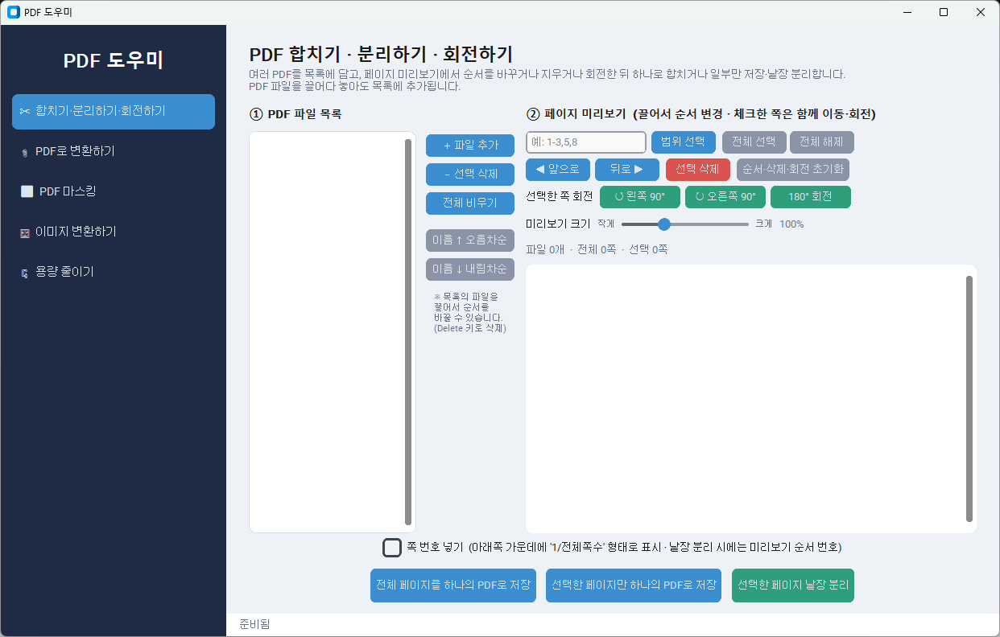

# 📄 PDF 도우미

PDF 합치기 · 분리하기 · 회전하기 · 변환 · 마스킹 · 용량 줄이기를 **설치 없이 클릭만으로** 할 수 있는 Windows용 PDF 도구입니다.
복잡한 설정 없이, 파일을 창 위로 끌어다 놓기만 하면 됩니다.

> 현재 버전: **3.0.0**



---

## ✨ 주요 기능

### 1. ✂ 합치기 · 분리하기 · 회전하기
- 여러 PDF를 목록에 담고(추가 / 삭제 / 순서 변경) **모든 페이지를 미리보기**로 확인
- 미리보기에서 페이지를 **끌어서 순서 변경** (체크한 여러 쪽을 한꺼번에 이동 가능)
- 선택한 페이지 **삭제**, **왼쪽 90° / 오른쪽 90° / 180° 회전** (미리보기에 바로 반영)
- 미리보기 크기를 슬라이더로 조절
- 전체를 하나로 저장 / **선택한 페이지만** 저장 / 선택한 페이지를 **낱장 파일로 분리**
- **쪽 번호 넣기** 옵션 (아래쪽 가운데에 `1/전체쪽수` 형태로 표시)
- 파일 목록 순서를 바꾸면 페이지도 목록 순서대로 다시 정렬 (직접 조정한 내용이 있으면 초기화 경고창 표시)

### 2. 📎 PDF로 변환하기
아래 형식을 **하나의 PDF**로 합쳐 저장합니다.

| 종류 | 확장자 |
|---|---|
| PDF | `.pdf` |
| 한글 | `.hwp` `.hwpx` |
| 엑셀 | `.xls` `.xlsx` `.xlsm` |
| 워드 | `.doc` `.docx` |
| 파워포인트 | `.ppt` `.pptx` |
| 이미지 | `.jpg` `.jpeg` `.png` `.bmp` |

- 쪽 번호 넣기 옵션 지원

### 3. ⬛ PDF 마스킹 (개인정보 가리기)
- 첫 쪽 미리보기에서 가릴 곳을 마우스로 끌어 네모를 그리면, **모든 쪽의 같은 위치**가 검은색으로 바뀝니다.
- 검은 도형을 위에 덮는 방식이 아니라 **그 자리의 글자·그림 자체를 삭제**하므로 복구할 수 없습니다.
- 여러 영역을 지정할 수 있고, 쪽 크기가 달라도 같은 비율 위치에 적용됩니다.

### 4. 🖼 이미지 변환하기
- PDF의 모든 페이지를 `jpg` / `png` / `bmp` 이미지로 저장 (해상도 72~300 DPI 선택)

### 5. 🗜 용량 줄이기
- **가장 많이 줄이기 / 많이 줄이기 / 보통으로 줄이기** 중에서 선택
- 페이지별 진행도 표시
- 결과가 원본보다 커지는 경우에는 원본 그대로 저장되어 **절대 용량이 늘어나지 않습니다.**

### 공통 기능
- 모든 화면에서 파일을 창 위로 **끌어다 놓기(드래그 앤 드롭)** 가능
- 파일 목록: 마우스로 순서 변경, `Delete` 키로 삭제, 이름 오름차순 / 내림차순 정렬
- 프로그램 실행 시 **새 버전을 자동 확인**하여 업데이트 안내 (인터넷이 막혀 있으면 조용히 넘어갑니다)

---

## 📥 다운로드 및 실행

1. 오른쪽 **[Releases](../../releases/latest)** 에서 최신 `PDF도우미.exe` 를 내려받습니다.
2. 내려받은 파일을 더블클릭하면 바로 실행됩니다. (별도 설치 필요 없음)

> ⚠️ **"Windows의 PC 보호" 경고가 뜨는 경우**
> 서명되지 않은 개인 제작 프로그램이라 처음 실행 시 경고가 나올 수 있습니다.
> **추가 정보 → 실행** 을 눌러 주세요.

---

## 💻 사용 환경

- **Windows 10 / 11** (64비트)
- 아래 기능은 해당 프로그램이 **PC에 설치되어 있어야** 합니다.

| 변환하려는 파일 | 필요한 프로그램 |
|---|---|
| `.hwp` `.hwpx` | 한컴오피스 한글 |
| `.xls` `.xlsx` `.xlsm` | Microsoft Excel |
| `.doc` `.docx` | Microsoft Word |
| `.ppt` `.pptx` | Microsoft PowerPoint |

- PDF 합치기·분리·회전·마스킹·이미지 변환·용량 줄이기, 이미지 → PDF 변환은 **다른 프로그램 없이** 동작합니다.
- 한글 파일 변환 시 접근 허용 팝업이 뜨면 **허용**을 눌러 주세요.

---

## 📖 간단 사용법

1. 프로그램을 실행하고 왼쪽 메뉴에서 원하는 기능을 고릅니다.
2. PDF 파일을 창 위로 끌어다 놓거나 **파일 추가** 버튼을 누릅니다.
3. 옵션을 조정한 뒤 아래쪽 **저장** 버튼을 누릅니다.
4. 원본 파일은 바뀌지 않고, 항상 **새 파일**로 저장됩니다.

### 자주 쓰는 팁
- **여러 쪽 한꺼번에 옮기기**: 옮길 쪽들을 체크한 뒤 그중 하나를 끌어다 놓습니다.
- **범위로 선택하기**: `1-3,5,8` 처럼 입력하고 **범위 선택**을 누릅니다.
- **실수했을 때**: **순서·삭제·회전 초기화** 버튼으로 처음 상태로 되돌릴 수 있습니다.

---

## ⚠️ 알아두실 점

- **암호가 걸린 PDF**는 처리할 수 없습니다. (암호를 먼저 해제해 주세요.)
- **마스킹은 복구할 수 없습니다.** 반드시 원본을 따로 보관하고, 저장된 `_마스킹.pdf` 파일을 배포하세요.
- 용량 줄이기 중 **가장 많이 줄이기**는 이미지가 큰 쪽을 통째로 그림으로 바꿀 수 있으며, 이 경우 해당 쪽의 글자 선택·검색이 되지 않습니다.
- 한글·오피스 파일 변환은 해당 프로그램이 실행되어 처리하므로 시간이 다소 걸릴 수 있습니다.

---

## 🛠 소스로 실행하기 (개발자용)

Python 3.10 이상을 권장합니다.

```bash
pip install pymupdf customtkinter pillow pywin32 tkinterdnd2
python pdf_helper.py
```

### exe 파일 만들기

```bash
pip install pyinstaller
pyinstaller --onefile --windowed --name "PDF도우미" ^
  --collect-all tkinterdnd2 --collect-all customtkinter pdf_helper.py
```

완성된 파일은 `dist` 폴더에 생성됩니다.

---

## 🔄 업데이트 안내 기능

프로그램을 켜면 저장소의 `version.json` 을 읽어 새 버전이 있는지 확인하고, 있으면 안내 팝업을 띄웁니다.

**새 버전을 배포하는 순서**

1. `pdf_helper.py` 의 `CURRENT_VERSION` 숫자를 올립니다.
2. exe를 새로 만들어 **Releases** 에 올립니다.
3. `version.json` 의 내용을 수정해 저장소에 올립니다.

```json
{
  "version": "3.0.1",
  "download_url": "https://github.com/tworemind-cpu/pdf_helper/releases/latest",
  "notes": "- 오류 수정\n- 속도 개선"
}
```

---

## 📝 변경 내역

### v3.0.0
- PDF 마스킹 기능 추가 (글자·그림 실제 삭제)
- 회전 기능을 '합치기·분리하기' 화면으로 통합 (왼쪽 90° / 오른쪽 90° / 180°)
- 쪽 번호 넣기 옵션 추가
- 업데이트 자동 확인 기능 추가

---

## 🙋 문의 및 오류 제보

사용 중 불편한 점이나 오류가 있다면 [Issues](../../issues) 에 남겨 주세요.
오류 메시지 화면과 어떤 작업을 하던 중이었는지 함께 적어 주시면 큰 도움이 됩니다.

## 📜 라이선스

개인·업무용으로 자유롭게 사용하실 수 있습니다. (라이선스는 필요에 맞게 수정하세요.)

> 이 프로그램은 [PyMuPDF](https://pymupdf.readthedocs.io/)(AGPL-3.0), CustomTkinter, Pillow, tkinterdnd2, pywin32 를 사용합니다.
> 소스를 공개하지 않고 배포하려는 경우 PyMuPDF의 라이선스 조건을 꼭 확인해 주세요.
